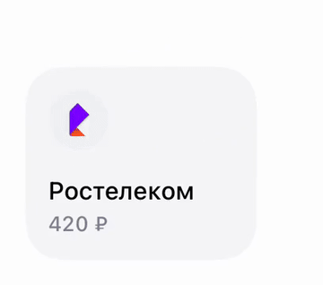

# 01 · Подсказка «Скоро оплата»

[← Все взаимодействия](../README.md) · [Логика раздела](../behaviour.md) · [Справочник значений](../motion-reference.json)

Статус: реализовано в прототипе. Единицы: мс и логические размеры интерфейса. Отсчёт времени начинается от события, описанного ниже.

## Зачем

Помочь заметить ближайшую оплату. Сообщение ощущается как лёгкая плашка, закреплённая за хвостик на карточке.

## Как запускается

У сохранённой операции есть текст напоминания. В ленте первое появление начинается, когда видно не менее половины карточки по ширине; в сетке — при появлении сообщения. Это показ текста, а не запуск автоплатежа.

Отдельный пример: `-demoOpen favourites-animations/reminder`.

## Пример и последовательность

[Видео с исходным темпом движения](../media/01-reminder.mp4) · [Раскадровка записи](../media/01-reminder-frames.jpg)

| От запуска | Что происходит |
|---|---|
| 0–100 мс | Короткая задержка; сообщение ещё не видно |
| 100–640 мс | Плашка вырастает из хвостика, проходит обычный размер и мягко возвращается к нему |
| 100–480 мс | Во время роста поворачивается от −17° к −4,2°: свободный край опускается |
| До 1 080 мс | Поворот и деформация затухают; итоговый наклон −8° |

Эти движения **перекрываются**. Не заканчивайте сначала масштаб, потом поворот: так появится эффект нескольких отдельных поз.

## Параметры и их смысл

| Параметр | Значение | Зачем |
|---|---|---|
| Опора | Нижняя точка хвостика | Она не перемещается при росте и повороте |
| Размер плашки | 108 × 52 | Постоянный конечный размер; карточка под ней не растёт |
| Масштаб | От почти 0 до 100%, пружина | Появление объёмом, без проявления всей плашки через прозрачность |
| Форма | Вытягивание при росте, затем небольшое расплющивание | Даёт ощущение инерции; площадь не меняется от одной деформации |
| Поворот | Относительно итоговых −8°: −9° → +3,8° → 0° | Один мягкий отклик вокруг неподвижного хвостика |

Размер и углы относятся к плашке целиком, включая хвостик. Обводка и текст движутся вместе. Координаты опоры берутся из геометрии компонента, а не из абсолютного места на экране.

## Повторное действие и прерывание

Обычный скролл уносит карточку и сообщение за край вместе. Возврат не повторяет вылет и не обнуляет сообщение. В редакторе напоминание скрыто. При уходе приложения в фон движение завершается; не запускайте его заново на каждом кадре видимости.

## Уменьшение движения и доступность

Сразу показываем конечную позу без роста, деформации и поворота. Смысл текста доступен через описание карточки; сама плашка не перехватывает нажатия.

## Как проверить

- [ ] Хвостик остаётся в одной точке на всех кадрах.
- [ ] Высота карточки не меняется: 102 в ленте и 108 в сетке.
- [ ] После скролла за край и обратно плашка не исчезает и не вылетает второй раз.
- [ ] На первом кадре нет вспышки полноразмерного сообщения.

## Где находится реализация

- [Components/FavouritesUpcomingPaymentMessage.swift](../../../WBSandbox/Components/FavouritesUpcomingPaymentMessage.swift)
- [Model/FavouritesReminderGeometry.swift](../../../WBSandbox/Model/FavouritesReminderGeometry.swift)
- [Components/WBMessageBubble.swift](../../../WBSandbox/Components/WBMessageBubble.swift)
- [Design/SandboxMotion.swift](../../../WBSandbox/Design/SandboxMotion.swift)

Платформенные параметры пружин и правила их переноса: [отдельный справочник](../implementation.md#как-перенести-движение-на-другую-платформу).

← [Обзор](../README.md) · [Протяжка и раскрытие колоды](02-deck-pull.md) →
