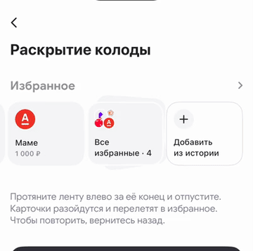

# 02 · Протяжка и раскрытие колоды

[← Все взаимодействия](../README.md) · [Логика раздела](../behaviour.md) · [Справочник значений](../motion-reference.json)

Статус: реализовано в прототипе. Единицы: мс и логические размеры интерфейса. Отсчёт времени начинается от события, описанного ниже.

## Зачем

Дать почувствовать, что за концом ленты есть полный список. Карточки расходятся под пальцем и продолжают движение в сетку.

## Как запускается

В конце ленты есть скрытые избранные; в эксперименте входом также служит непустая папка «Все избранные». Пользователь намеренно тянет ленту дальше её правого края. Обычная прокрутка до края сама раздел не открывает.

Отдельный пример: `-demoOpen favourites-animations/deck-pull`.

## Пример и последовательность

[Видео с исходным темпом движения](../media/02-deck-pull.mp4) · [Раскадровка записи](../media/02-deck-pull-frames.jpg)

В записи используется кнопка «Показать раскрытие» из отдельного примера: она
подаёт 72 единицы протяжки в ту же модель жеста за 360 мс и через 400 мс
запускает переход. Это способ повторить пример, а не фиксированное время
реального движения пальца.

| Действие | Что происходит |
|---|---|
| Дотянули до конца | Из-под последней карточки или папки видны до двух следующих избранных |
| Тянем дальше | Разрывы между соседями растут; уголки стопки расходятся и поворачиваются |
| Протяжка достигла 72 | Переход взведён, есть отчётливый тактильный отклик |
| Отпустили, сохранив не менее 54 | Карточки продолжают путь в сетку через общий перелёт |
| Вернули протяжку ниже 54 и отпустили | Отмена готовности; колода мягко собирается обратно |

Прогресс раскрытия равен расстоянию протяжки / 72, ограниченному от 0 до 1. Это управление пальцем, поэтому у раскрытия нет фиксированной длительности.

## Параметры и их смысл

| Параметр | Значение | Зачем |
|---|---|---|
| Порог готовности | 72 логические единицы сверх конца | Отличает намерение открыть от небольшого отскока |
| Порог отмены готовности | Меньше 54 | Не даёт состоянию дрожать на границе 72 |
| Дополнительный зазор | До 20 между соседями | Видимая связь с глубиной протяжки; базовый зазор ленты 4 |
| Карточки под стопкой | Не более двух видимых слоёв | Сигнал продолжения без перегрузки |
| Непрозрачность карточек | 100% | Не видно содержимое сквозь заливку |
| Обводка стопки | 1 единица | Разделяет соседние формы |

Ближний слой начинается с масштаба 114/122 и поворота +4°, дальний — 106/122 и −8°. При раскрытии они дополнительно смещаются наружу и поворачиваются до +12° / −14°. Это геометрия слоёв, а не отдельные карточки-заглушки.

## Повторное действие и прерывание

До отпускания можно менять направление. Инерция обычного скролла не считается новым намеренным жестом. Повторное открытие во время перехода блокируется. При отмене используется пружина со скоростью 380 мс и затуханием 0,86; при успешном отпускании — [общий перелёт](04-header-flight.md).

## Уменьшение движения и доступность

Раздвигание и вращение отключены. Открытие остаётся доступно по заголовку и папке; переход в раздел — короткое проявление за 150 мс. Распознавание намеренного жеста сохраняется.

## Как проверить

- [ ] Лёгкий отскок и обычная инерция не открывают избранное.
- [ ] На 72 переход готов; возврат ниже 54 отменяет его.
- [ ] История остаётся отдельной последней карточкой.
- [ ] Между стопкой и сеткой нет отдельного второго push-перехода.

## Где находится реализация

- [Model/FavouritesDeckInteraction.swift](../../../WBSandbox/Model/FavouritesDeckInteraction.swift)
- [Components/FavouritesDeckFlight.swift](../../../WBSandbox/Components/FavouritesDeckFlight.swift)
- [Screens/FavouritesPaymentsScreen.swift](../../../WBSandbox/Screens/FavouritesPaymentsScreen.swift)

Платформенные параметры пружин и правила их переноса: [отдельный справочник](../implementation.md#как-перенести-движение-на-другую-платформу).

← [Подсказка «Скоро оплата»](01-reminder.md) · [Открытие по заголовку: Move In](03-header-move-in.md) →
