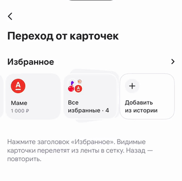

# 04 · Перелёт видимых карточек в сетку

[← Все взаимодействия](../README.md) · [Логика раздела](../behaviour.md) · [Справочник значений](../motion-reference.json)

Статус: реализовано в прототипе. Единицы: мс и логические размеры интерфейса. Отсчёт времени начинается от события, описанного ниже.

## Зачем

Сохранить узнаваемость операции при переходе: пользователь видит, как карточка из ленты занимает место в полном списке.

## Как запускается

Тап по заголовку, когда хотя бы одна сохранённая карточка пересекает экран. Эту же механику запускает успешная протяжка. Источником служит измеренная позиция карточки или её слой в стопке.

Отдельный пример: `-demoOpen favourites-animations/header-flight`.

## Пример и последовательность

[Видео с исходным темпом движения](../media/04-header-flight.mp4) · [Раскадровка записи](../media/04-header-flight-frames.jpg)

| Этап | Что происходит |
|---|---|
| Подготовка | Измеряем текущие позиции ленты и конечные места сетки |
| Начало | Поверх экранов появляются карточки в точных исходных размерах и поворотах; дубликаты под ними скрыты |
| Перелёт | Каждая карточка движется к своему месту; ширина и высота становятся размерами сетки, наклон уходит к 0° |
| Одновременно | ПиП уступает место сетке; текст и сумма переходят к формату полного раздела |
| Завершение | Временные летящие карточки снимаются, на их месте остаются настоящие карточки сетки |

Не запускайте дополнительный слайд после перелёта. Это один переход с общим прогрессом.

## Параметры и их смысл

| Параметр | Значение | Зачем |
|---|---|---|
| Откуда и куда | Фактические границы карточек до и после перехода | Работает на разных ширинах экрана и при разном скролле |
| Пружина | Скорость 560 мс, затухание 0,86 | Небольшой живой отклик, затем фиксация в сетке |
| Конечный размер | Половина ширины контейнера сетки, высота 108 | Геометрия принадлежит раскладке |
| Конечные масштаб/наклон | 100% / 0° | Карточка встраивается без скачка |
| Заливка в полёте | Непрозрачная | Ни одна другая карточка не просвечивает |
| Временная тень | От 0 к 7% и обратно, радиус 12 | Слегка отделяет объект в середине пути |

Обводка слоёв исчезает по мере встраивания в сетку; прозрачность заливки при этом не уменьшается. Время подготовки измерений не является художественной паузой.

## Повторное действие и прерывание

Карточки ниже видимой области сетки не поднимаются поверх нижней панели. Если не получилось получить видимые цели, завершается общий переход без полёта пустых объектов. Нажатия на время перехода заблокированы. Возврат занимает 240 мс; отдельного обратного перелёта карточек сейчас нет.

## Уменьшение движения и доступность

Перелёт, повороты и деформация размеров отключаются. Экран меняется коротким проявлением за 150 мс.

## Как проверить

- [ ] Первый кадр полёта совпадает с последним кадром ленты.
- [ ] Последний кадр совпадает с настоящей сеткой.
- [ ] Не видно двух экземпляров одной карточки.
- [ ] Карточки, текст и суммы не скачут в момент снятия временного слоя.

## Где находится реализация

- [Components/FavouritesDeckFlight.swift](../../../WBSandbox/Components/FavouritesDeckFlight.swift)
- [Screens/FavouritesPaymentsScreen.swift](../../../WBSandbox/Screens/FavouritesPaymentsScreen.swift)
- [Screens/SavedFavouritesScreen.swift](../../../WBSandbox/Screens/SavedFavouritesScreen.swift)

Платформенные параметры пружин и правила их переноса: [отдельный справочник](../implementation.md#как-перенести-движение-на-другую-платформу).

← [Открытие по заголовку: Move In](03-header-move-in.md) · [Добавление новой карточки в сетку](05-grid-insertion.md) →
