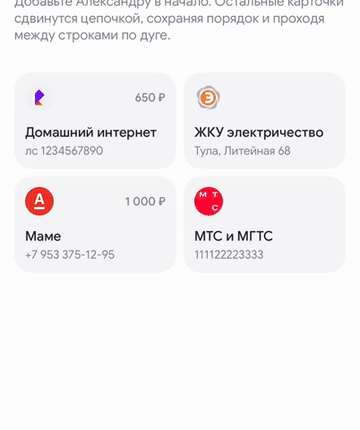

# 05 · Добавление новой карточки в сетку

[← Все взаимодействия](../README.md) · [Логика раздела](../behaviour.md) · [Справочник значений](../motion-reference.json)

Статус: реализовано в прототипе. Единицы: мс и логические размеры интерфейса. Отсчёт времени начинается от события, описанного ниже.

## Зачем

Показать, что добавилось именно новое избранное, и дать проследить, куда переместились прежние операции.

## Как запускается

Пользователь сохранил шаблон, редактор и история полностью закрылись. Новая карточка уже добавлена первой в данные; прежние карточки сохраняют свои id и порядок.

Отдельный пример: `-demoOpen favourites-animations/grid-insertion`.

## Пример и последовательность

[Видео с исходным темпом движения](../media/05-grid-insertion.mp4) · [Раскадровка записи](../media/05-grid-insertion-frames.jpg)

| От обновления видимой сетки | Что происходит |
|---|---|
| 0 мс | Ближайший старый сосед начинает освобождать первый слот |
| Затем каждые 85 мс | Следующий сосед подхватывает движение |
| 270 мс | Новая карточка начинает расти в освободившемся первом месте |
| 270–990 мс | Масштаб, лёгкая деформация и один световой импульс; карточка успокаивается |
| До 1 005 мс | Даже дальние соседи доходят до новых мест |

Каждый сосед движется 580 мс. Задержка одного соседа ограничена 425 мс, поэтому длинная сетка не проигрывает многосекундную волну.

## Параметры и их смысл

| Параметр | Значение | Зачем |
|---|---|---|
| Шаг цепочки | 85 мс | Видно, как движение передаётся от соседа к соседу |
| Движение соседа | 580 мс, мягкий старт и остановка | Успеваем проследить ту же карточку |
| Новая карточка | Масштаб 4% → 100%, старт после 270 мс | Сначала освобождается место, затем вырастает новый объект |
| Деформация | Начальная форма 0,84; промежуточная цель 1,045; итог 1 | Короткое вытягивание и расплющивание без изменения конечной геометрии |
| Свет | До 22% светлой подложки, один импульс 720 мс | Акцент на новом элементе; не мигает повторно |
| Сетка | Две колонки, зазор 8, высота 108 | Конечные слоты берутся из раскладки |

Внутри строки карточка движется прямо. Между строками — по дуге: сначала проходит у правого края, затем встаёт в следующий слот. Дуга вычисляется от текущих позиций, не от номера конкретного телефона.

## Повторное действие и прерывание

Новая вставка во время движения начинается из текущих промежуточных позиций соседей. Открытие уже заполненного раздела не повторяет вставку. Изменение названия или суммы существующего id не считается добавлением. В горизонтальной ленте эта анимация выключена, включая замену заполненного слота.

## Уменьшение движения и доступность

Новая карточка и вся раскладка сразу показываются в конечном состоянии, без масштаба, светового импульса и цепочки.

## Как проверить

- [ ] Прежний «Домашний интернет» действительно едет вправо, а не заменяется похожей карточкой в другом слоте.
- [ ] Переход через границу строки непрерывен.
- [ ] Новая карточка начинает появляться после закрытия формы.
- [ ] Повторное открытие раздела не проигрывает сохранённое добавление.

## Где находится реализация

- [Components/FavouritesAnimatedCollection.swift](../../../WBSandbox/Components/FavouritesAnimatedCollection.swift)
- [Model/FavouritesInsertion.swift](../../../WBSandbox/Model/FavouritesInsertion.swift)
- [Design/SandboxMotion.swift](../../../WBSandbox/Design/SandboxMotion.swift)
- [Screens/SavedFavouritesScreen.swift](../../../WBSandbox/Screens/SavedFavouritesScreen.swift)

Платформенные параметры пружин и правила их переноса: [отдельный справочник](../implementation.md#как-перенести-движение-на-другую-платформу).

← [Перелёт видимых карточек в сетку](04-header-flight.md) · [Сохранение уже видимой рекомендации](06-promotion.md) →
