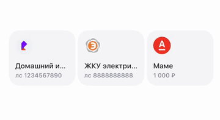

# 06 · Сохранение уже видимой рекомендации

[← Все взаимодействия](../README.md) · [Логика раздела](../behaviour.md) · [Справочник значений](../motion-reference.json)

Статус: реализовано в прототипе. Единицы: мс и логические размеры интерфейса. Отсчёт времени начинается от события, описанного ниже.

## Зачем

Подтвердить сохранение операции, которая уже видна в ленте, не создавая второй экземпляр и не изображая вставку нового слота.

## Как запускается

Пришло событие сохранения того же id, который уже есть в видимой подборке; состав и порядок карточек ленты не изменились.

Отдельный пример: `-demoOpen favourites-animations/promotion`.

## Пример и последовательность

[Видео с исходным темпом движения](../media/06-promotion.mp4) · [Раскадровка записи](../media/06-promotion-frames.jpg)

| От визуального события | Что происходит |
|---|---|
| 0–340 мс | Короткая задержка акцента |
| 340–460 мс | Карточка уменьшается до 90%, слегка расплющивается |
| 460–1 060 мс | Пружина возвращает размер и форму; световой импульс затухает |

Соседи остаются в своих слотах. Эта реакция отличается от удалённой анимации добавления новой карточки в ленту.

## Параметры и их смысл

| Параметр | Значение | Зачем |
|---|---|---|
| Задержка | 340 мс | Отделяет акцент карточки от закрытия формы |
| Сжатие | 100% → 90% за 120 мс | Короткий тактильный отклик |
| Возврат | 600 мс, мягкая пружина | Один контролируемый отскок |
| Изменение формы | 1 → 1,04 → 1 | Небольшая деформация вместе со сжатием |
| Свет | До 22%, один импульс | Подчёркивает сохранение без отдельного баннера |

Если после сохранения набор ленты изменился, лента просто обновляется. Не применяйте этот эффект к чужой карточке, занявшей прежний индекс.

## Повторное действие и прерывание

Каждое событие сохранения имеет свой идентификатор и проигрывается коллекцией один раз. Обычный пересчёт вёрстки, скролл или вход в раздел не запускает акцент заново.

## Уменьшение движения и доступность

Показывается сохранённое состояние без сжатия, деформации и света.

## Как проверить

- [ ] На экране остаётся тот же id, без второго экземпляра.
- [ ] Соседи не разъезжаются.
- [ ] Эффект не возвращает удалённое «Добавление в ленту».

## Где находится реализация

- [Components/FavouritesAnimatedCollection.swift](../../../WBSandbox/Components/FavouritesAnimatedCollection.swift)
- [Design/SandboxMotion.swift](../../../WBSandbox/Design/SandboxMotion.swift)
- [Screens/FavouritesAnimations/FavouritesPromotionDemoScreen.swift](../../../WBSandbox/Screens/FavouritesAnimations/FavouritesPromotionDemoScreen.swift)

Платформенные параметры пружин и правила их переноса: [отдельный справочник](../implementation.md#как-перенести-движение-на-другую-платформу).

← [Добавление новой карточки в сетку](05-grid-insertion.md) · [Покачивание в режиме редактирования](07-wiggle.md) →
