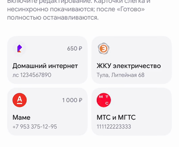

# 07 · Покачивание в режиме редактирования

[← Все взаимодействия](../README.md) · [Логика раздела](../behaviour.md) · [Справочник значений](../motion-reference.json)

Статус: реализовано в прототипе. Единицы: мс и логические размеры интерфейса. Отсчёт времени начинается от события, описанного ниже.

## Зачем

Тихо показать смену режима. Карточки должны ощущаться доступными для изменения, не превращая сетку в сильную тряску.

## Как запускается

Пользователь нажал карандаш. Появляются крестики; тап по карточке теперь открывает редактор, а не оплату.

Отдельный пример: `-demoOpen favourites-animations/wiggle`.

## Пример и последовательность

[Видео с исходным темпом движения](../media/07-wiggle.mp4) · [Раскадровка записи](../media/07-wiggle-frames.jpg)

| Этап | Что происходит |
|---|---|
| Первые 160 мс | Амплитуда постепенно набирается от нуля |
| Редактирование включено | Слабые повороты и вертикальное покачивание повторяются; карточки не синхронны |
| «Готово», удаление или открытие формы | Покачивание прекращается; в обычной сетке наклон и смещение равны нулю |

В отдельном примере крестики служат только иллюстрацией режима; настоящее удаление проверяется на [соседней странице](08-removal.md).

## Параметры и их смысл

| Параметр | Значение | Зачем |
|---|---|---|
| Движение угла от поворота | Около 1,6 логической единицы | Амплитуда зависит от размера: широкая карточка вращается слабее |
| Вертикальное смещение | До ±0,35 | Едва заметная живость |
| Полный цикл поворота | Примерно 360–430 мс | Мягкий ритм; разброс делает соседей несинхронными |
| Полный цикл вертикали | Примерно 440–490 мс | Отличается от поворота, нет строевого движения |
| Начальная фаза | Стабильно определяется id | Карточки движутся по-разному, но не получают случайный рывок на каждом кадре |

Для карточки около 175 × 108 угол поворота составляет примерно ±0,9°. Это ориентир: не закрепляйте этот угол для карточек любой ширины.

## Повторное действие и прерывание

Факт редактирования — единственный источник включения. Восстановленная после удаления карточка в обычном режиме неподвижна. Нельзя оставлять бесконечную анимацию, живущую отдельно от режима. При открытой форме общий список тоже не покачивается.

## Уменьшение движения и доступность

Покачивание полностью выключено. Режим остаётся понятен по крестику, кнопке «Готово» и текстовой подсказке. В фоне анимация не выполняется.

## Как проверить

- [ ] Соседи не поворачиваются в одну сторону одновременно.
- [ ] После «Готово» нет остаточного угла и вертикального сдвига.
- [ ] Удаление → отмена не оставляет одну дрожащую карточку среди неподвижных.
- [ ] На широкой карточке амплитуда не становится сильнее.

## Где находится реализация

- [Components/FavouritesCardWiggle.swift](../../../WBSandbox/Components/FavouritesCardWiggle.swift)
- [Screens/SavedFavouritesScreen.swift](../../../WBSandbox/Screens/SavedFavouritesScreen.swift)
- [Screens/FavouritesAnimations/FavouritesWiggleDemoScreen.swift](../../../WBSandbox/Screens/FavouritesAnimations/FavouritesWiggleDemoScreen.swift)

Платформенные параметры пружин и правила их переноса: [отдельный справочник](../implementation.md#как-перенести-движение-на-другую-платформу).

← [Сохранение уже видимой рекомендации](06-promotion.md) · [Удаление, цепочка и отмена](08-removal.md) →
