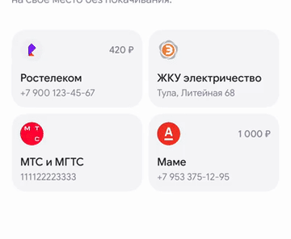

# 08 · Удаление, цепочка и отмена

[← Все взаимодействия](../README.md) · [Логика раздела](../behaviour.md) · [Справочник значений](../motion-reference.json)

Статус: реализовано в прототипе. Единицы: мс и логические размеры интерфейса. Отсчёт времени начинается от события, описанного ниже.

## Зачем

Показать, какая карточка убрана, и позволить проследить, как остальные закрывают место. Отмена должна быть видимым продолжением этого движения.

## Как запускается

Крестик в режиме редактирования или «Убрать» в редакторе. Избранное удаляется из данных сразу; исчезновение и перестроение — визуальное подтверждение уже выполненного действия.

Отдельный пример: `-demoOpen favourites-animations/removal`.

## Пример и последовательность

[Видео с исходным темпом движения](../media/08-removal.mp4) · [Раскадровка записи](../media/08-removal-frames.jpg)

| От удаления | Что происходит |
|---|---|
| 0 мс | Запускается пятисекундное окно отмены, появляется тост; сетка выходит из редактирования |
| 0–240 мс | Удаляемая карточка уменьшается и теряет непрозрачность на своём месте |
| 120 мс | Ближайший следующий сосед начинает закрывать пустой слот |
| Затем каждые 85 мс | Следующие карточки подхватывают движение |
| До 1 125 мс | Даже хвост длинной сетки доходит до своих мест |
| Через 5 000 мс от удаления | Тост закрывается; отмена этого удаления больше не принимается |

Каждый сосед движется 580 мс, как при добавлении. Карточки перед местом удаления остаются на своих местах. Последняя строка не обрезается до окончания движения.

## Параметры и их смысл

| Параметр | Значение | Зачем |
|---|---|---|
| Схлопывание | 240 мс, плавный старт/финиш | Удаляемый объект видимо освобождает место |
| Масштаб/непрозрачность выхода | 100% → почти 0 / 100% → 0 | Карточка не исчезает одним кадром |
| Задержка первого соседа | 120 мс | Даёт схлопыванию начаться, не ждёт полного конца |
| Шаг цепочки | 85 мс | Убирает одновременный сдвиг всей сетки |
| Максимальная задержка соседа | 545 мс, включая первые 120 | Ограничивает ожидание дальнего хвоста |
| Отмена | Пять секунд от изменения данных | Время анимации не продлевает срок и не влияет на сохранность |

Тост: отсчёт 5 → 1, убывающее кольцо, «Убрали из избранного», «Отменить». В конце он уходит с коротким затуханием 200 мс. Его размер не определяет геометрию сетки.

## Повторное действие и прерывание

Отмена возвращает карточку между прежними соседями; если соседи изменились, сначала ищем следующего, затем предыдущего, затем используем допустимый старый индекс. До окончания движения берём текущие позиции и масштаб, разворачиваем их к восстановленному состоянию. После окончания возвращение использует механику вставки на прежнее место. Повторная отмена не создаёт дубль. На границе пяти секунд она уже недоступна. Новое удаление заменяет предыдущее окно отмены. Удаление последней карточки приводит к пустому состоянию; история остаётся.

## Уменьшение движения и доступность

Раскладка и карточки сразу принимают конечное состояние. Тост и возможность отмены сохраняются. Таймер остаётся таймером данных, не анимации.

## Как проверить

- [ ] Удаление из начала и середины двигает только нужных соседей и по очереди.
- [ ] Траектория через строку непрерывна и обратна добавлению.
- [ ] Быстрая отмена не прыгает сначала в конечную позицию удаления.
- [ ] После отмены вне редактирования все карточки неподвижны.
- [ ] Повторная отмена, истёкший срок и удаление последней карточки обработаны.

## Где находится реализация

- [Components/FavouritesAnimatedCollection.swift](../../../WBSandbox/Components/FavouritesAnimatedCollection.swift)
- [Model/FavouritesInsertion.swift](../../../WBSandbox/Model/FavouritesInsertion.swift)
- [Model/FavouritesRemoval.swift](../../../WBSandbox/Model/FavouritesRemoval.swift)
- [Components/FavouritesSnackbar.swift](../../../WBSandbox/Components/FavouritesSnackbar.swift)
- [Screens/SavedFavouritesScreen.swift](../../../WBSandbox/Screens/SavedFavouritesScreen.swift)

Платформенные параметры пружин и правила их переноса: [отдельный справочник](../implementation.md#как-перенести-движение-на-другую-платформу).

← [Покачивание в режиме редактирования](07-wiggle.md) · [Сохранение с сердцем Pow Pop](09-heart-pop.md) →
