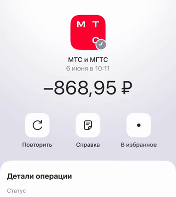

# 09 · Сохранение с сердцем Pow Pop

[← Все взаимодействия](../README.md) · [Логика раздела](../behaviour.md) · [Справочник значений](../motion-reference.json)

Статус: реализовано в прототипе. Единицы: мс и логические размеры интерфейса. Отсчёт времени начинается от события, описанного ниже.

## Зачем

Подтвердить сохранение прямо в кнопке: сначала кольцо, затем частицы и заполненное сердце. Цвет остаётся обычным text/icon Primary.

## Как запускается

Первый тап «В избранное» на деталях операции. Состояние сохраняется и надпись меняется на «В избранном» сразу. Визуальный эффект не задерживает действие.

Отдельный пример: `-demoOpen favourites-animations/heart`.

## Пример и последовательность

[Видео с исходным темпом движения](../media/09-heart-pop.mp4) · [Раскадровка записи](../media/09-heart-pop-frames.jpg)

| От нажатия | Что происходит |
|---|---|
| 0 мс | Состояние сохранено, контур сменяется эффектом; начинает расти кольцо |
| 180 мс | Из центра начинается вырезание кольца: видна расширяющаяся кромка |
| Около 400 мс | Начинают разлетаться двадцать частиц |
| Около 480 мс | Из центра быстро вырастает заполненное сердце |
| До 1 200 мс | Частицы и кольцо исчезают, остаются сердце и «В избранном» |

Слои перекрываются по времени. Это **Pop из библиотеки Pow**, не Poof/Puff и не обычное увеличение иконки с конфетти.

## Параметры и их смысл

| Параметр | Значение | Зачем |
|---|---|---|
| Общая длина эффекта | 1 200 мс | Граница визуальной обратной связи; действие уже выполнено |
| Иконка | 24 × 24 | Не меняет размер самой кнопки |
| Частицы | 20, маленькие круги, радиально | Характер исходного Pow Pop |
| Цвет всех слоёв | text/icon Primary | Нет розового сердца или разноцветных частиц |
| Движение | Быстрое начало и экспоненциальное затухание | Узнаваемый Pop; не подменять линейной интерполяцией |
| Случайность | Новая при запуске, стабильная на всём протяжении эффекта | Частицы не перескакивают между траекториями на кадрах |

Кольцо строится заливкой и вырезанием центра, а не отдельной обводкой постоянной толщины. Эффект выходит за границы 24 × 24: не обрезайте его областью иконки.

## Повторное действие и прерывание

В полном сценарии второй тап открывает редактор, не удаляет избранное. В отдельной демонстрации кнопку можно переключать для проверки, но это не продуктовое поведение. После возвращения на уже сохранённую операцию эффект не повторяется сам. Закрытие экрана или уход приложения в фон завершает частицы.

## Уменьшение движения и доступность

Сразу видны заполненное сердце и «В избранном», без кольца, частиц и увеличения. Сохранение доступно независимо от движения.

## Как проверить

- [ ] Первое нажатие меняет состояние немедленно.
- [ ] Сердце и частицы используют один семантический цвет в светлой и тёмной теме.
- [ ] Повторный тап ведёт в редактор.
- [ ] После 1 200 мс нет фонового цикла частиц.

## Где находится реализация

- [Components/OperationFavouriteIcon.swift](../../../WBSandbox/Components/OperationFavouriteIcon.swift)
- [Screens/OperationDetailsScreen.swift](../../../WBSandbox/Screens/OperationDetailsScreen.swift)
- [Resources/ThirdParty/Pow-LICENSE.txt](../../../WBSandbox/Resources/ThirdParty/Pow-LICENSE.txt)

Платформенные параметры пружин и правила их переноса: [отдельный справочник](../implementation.md#как-перенести-движение-на-другую-платформу).

← [Удаление, цепочка и отмена](08-removal.md) · [Проверка реализации](../verification.md) →
