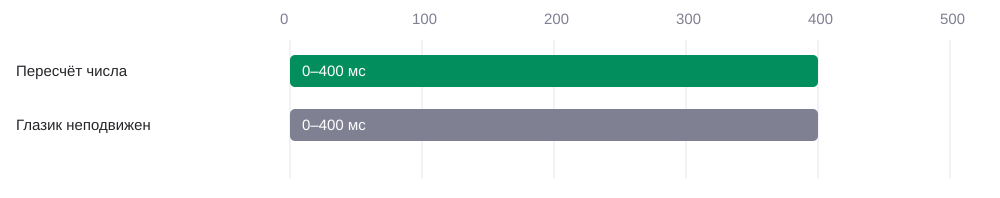

# 01 · Смена общей суммы

[← Все взаимодействия](../README.md) · [Логика](../behaviour.md) · [Параметры](../motion-reference.json)

Версия 4 · 10 ноября 2026. Пересчёт сохраняется из `wb-test`; масштабирование и неподвижный глазик ниже — новые требования, а не утверждение об их реализации в опубликованном прототипе.

## Зачем

Показать изменение доступной суммы при смене режима, сохранив читаемость длинных значений. Сумма занимает одну строку, при нехватке ширины уменьшается шрифт. Высота блока и позиция кнопки скрытия не зависят от длины суммы.

## Как запускается

Нажать «На ВБ» или «Для любых покупок». Момент 0 — изменение режима и целевого баланса. Повторный тап по выбранному режиму ничего не запускает. Данные меняются сразу; анимируется только отображение.

Демонстрационная пара **95 775 ₽ ↔ 154 261 ₽** не ограничивает количество разрядов или диапазон сумм. Наборы счетов и формулы итогов остаются прежними.

## Пример и последовательность

| От нажатия | Что происходит |
|---|---|
| 0 мс | Берём новое значение без округления, отбрасываем копейки, форматируем строку и рассчитываем доступную ширину |
| 0 мс | Подбираем размер по [правилам масштабирования](../amount-scaling.md); глазик остаётся в своём слоте |
| 0–400 мс | Число непрерывно пересчитывается, easing `cubic-bezier(0.22, 1, 0.36, 1)` |
| На каждом кадре | Показанное значение без копеек; нет переноса, многоточия или наложения на глазик |
| 400 мс | Показана целая часть целевого значения; шрифт и правый fade соответствуют доступной ширине |

Цифры не вращаются и не вылетают по одной. Сохраняются табличные разряды и плавный пересчёт. Подбор размера не запускается заново от каждой промежуточной цифры: это вызовет дрожание. Для перехода учитываются текущая и целевая строки; изменение количества групп тысяч также входит в измерение. Новое значение, изменение ширины экрана или системного масштаба требуют нового расчёта.

Глазик **не следует за правой границей текста**. Его слот резервируется до измерения; он не сдвигается и не переносится при пересчёте или уменьшении шрифта. Сумма и ₽ остаются внутри доступной текстовой области. Центрирование всей группы вместе с глазиком, описанное в версии 3, больше не является требованием.

### Архивный пример движения

[Запись пересчёта от 22 октября](../media/mode-switch.mp4) · [GIF](../media/mode-switch.gif) · [Кадры](../media/balance-frames.jpg).

Эти материалы иллюстрируют характер пересчёта, но содержат прежнее перемещение глазика и не демонстрируют уменьшение шрифта / правый fade. Они не являются эталоном новой компоновки.

## Параметры

| Параметр | Значение и видимый результат |
|---|---|
| Пересчёт | 400 мс от нажатия; `cubic-bezier(0.22, 1, 0.36, 1)` |
| Представление суммы | Целая часть без округления; группы тысяч через пробел, затем пробел и ₽ |
| Порог длины | 12 символов, включая все пробелы и ₽; более длинные строки не обрезаем до 12 |
| Уменьшение шрифта | Каждый шаг × 0.9 от текущего размера, с повторным измерением |
| Минимум | 16 sp; последний шаг ограничивается этим минимумом |
| Межстрочный интервал | Уменьшается пропорционально кеглю |
| Переполнение на минимуме | Fade справа в текстовой области; многоточия нет |
| Высота блока | Постоянна для данной компоновки |
| Глазик | Положение и размер области нажатия постоянны при смене суммы |
| Системный масштаб | Тот же алгоритм до 150%; измерять фактически отрисованный текст |
| Reduced motion | Конечное число сразу; подбор шрифта и fade работают по тем же правилам |

Базовый кегль, базовый межстрочный интервал, высота контейнера и отступы приходят из актуального макета. Их не следует кодировать как параметры плавности или выводить из одной демонстрационной суммы. Алгоритм, формулы и примеры: [«Главная сумма. Масштабирование шрифта»](../amount-scaling.md).

## Повторное действие и прерывание

Нажатия не блокируются. Новый пересчёт продолжается с текущего внутреннего дробного значения интерполяции, а не с нуля или старой цели. Форматирование промежуточного значения не меняет исходную денежную модель. Геометрия не возвращается к старому состоянию; новый подбор размера учитывает текущую строку и новую цель.

При уходе со страницы анимация очищается. Возврат из внутреннего пустого экрана сохраняет режим; перезагрузка демо начинает с «Для любых покупок».

## Доступность

Скрытая сумма остаётся скрытой при смене режима. Глазик сохраняет название, состояние и область нажатия. Для assistive technology доступна полная конечная строка без копеек, включая часть, которая визуально закрыта fade. Промежуточные значения не объявляются на каждом кадре. Сумму в скрытом состоянии не озвучивать.

Существующая анимация скрытия/показа остаётся отдельной: opacity 400 мс, задержка показа 120 мс; линия скрытия появляется за 650 мс, убирается за 500 мс. В reduced motion opacity 250 мс, линия мгновенная. Правый fade переполнения — другое состояние и не заменяет эту механику.

## Проверка

- [ ] Через 400 мс показана целая часть новой суммы, без округления копеек вверх.
- [ ] На каждом кадре одна строка; текст не сталкивается с ₽ и глазиком.
- [ ] Высота блока и координаты глазика не меняются от суммы.
- [ ] Размер выбирается по реальному тексту, доступной ширине и системному масштабу, а не только по числу цифр.
- [ ] Выполнены примеры и граничные проверки из [масштабирования](../amount-scaling.md#приёмка).
- [ ] Быстрые смены режима продолжают пересчёт от текущего значения.
- [ ] Скрытые суммы не вспыхивают; reduced motion показывает итог сразу.

## Исходники и статус

[source/](../source/) — архив реализации на 22 октября, **не реализация версии 4**. В нём сохраняются `Math.round`, резерв шести цифр, движение глазика и старые проверки геометрии. Переносить эти решения как новые требования нельзя. Новые требования проверяются отдельно; обновление документации не означает изменение приложения.

[Карточки карусели →](02-accounts.md)
