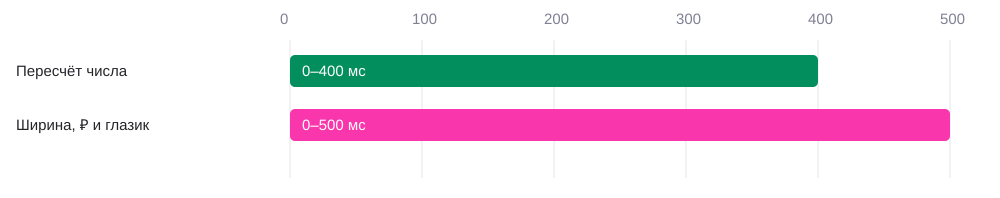

# 01 · Смена общей суммы

[← Все взаимодействия](../README.md) · [Логика](../behaviour.md) · [Параметры](../motion-reference.json)

Статус: реализовано на `wb-test`. Версия 2 · 22 октября 2026.

## Зачем

Показать, что доступная сумма изменилась вместе с режимом покупок. Пользователь видит непрерывный пересчёт от прежней суммы к новой, а знак валюты и глазик плавно освобождают место для другого количества разрядов.

## Как запускается

На главном экране нажать «На ВБ» или «Для любых покупок». Момент 0 — изменение выбранного режима. Новый целевой баланс вычисляется сразу; анимация не откладывает изменение данных. Нажатие уже выбранного режима не запускает новый пересчёт.

Пример: **95 775 ₽ → 154 261 ₽** и обратно. [Открыть прототип](https://lyosha.fun/wb-test/).

## Пример и последовательность

[Видео в исходном темпе](../media/mode-switch.mp4) · [Кадры прототипа с управляемым временем](../media/balance-frames.jpg)

| От нажатия | Элемент | Что видно |
|---|---|---|
| 0 мс | Данные | Установлен новый целевой баланс |
| 0–400 мс | Число | Непрерывная интерполяция; на каждом кадре округление до целого рубля |
| 0–400 мс | Ширина суммы | Из текущей ширины в измеренную ширину конечной строки |
| 0–400 мс | ₽ и глазик | Следуют за правой границей суммы; не прыгают при переходе через 100 000 |
| 400 мс | Число | Уже точно равно целевому значению |
| 400 мс | Компоновка | Останавливается вместе с числом; второй фазы смещения нет |

Цифры не вращаются и не выезжают по очереди. Маска появления карточек к числу не применяется. Отсутствуют масштаб, поворот и изменение прозрачности при обычной смене режима. Разряды занимают ячейки одинаковой ширины: их взаимные расстояния не меняются от значения цифр. Во время пересчёта вся группа плавно смещается по ширине конечной суммы. Это одно монотонное движение, а не покадровое центрирование промежуточных строк. Центр группы учитывает 12 px внутреннего отступа слева: на экране 390 px это X=201 px. После 400 мс дополнительного сдвига нет.

## Параметры и их смысл

| Параметр | Значение | Что меняет |
|---|---|---|
| Пересчёт | 400 мс; cubic-bezier(0.22, 1, 0.36, 1) | Быстро набирает большую часть разницы и мягко останавливается |
| Отображение | Округление ближайшего целого; разделение тысяч пробелом | Стабильное денежное представление без копеек |
| Ширина строки | 400 мс; cubic-bezier(0.22, 1, 0.36, 1); задержка 0 мс | Начинается и заканчивается одновременно с числом; ₽ и глазик следуют за раскладкой |
| Начальная ширина | Текущая фактическая ширина | При прерывании нет возврата к прежнему размеру |
| Конечная ширина | Измеренная сумма в фиксированных ячейках + gap 8 px + ячейка ₽ | Для конечной строки не резервируется лишний ведущий разряд; блок соответствует пяти или шести цифрам |
| Разделение числа и ₽ | gap 8 px между колонками; текстовый пробел визуально нулевой | Нет двойного отступа или наложения глифов |
| Глазик | Следом за блоком суммы; внешний зазор 8 px | Движется синхронно с ₽ без собственной независимой траектории |
| Шрифт | Google Sans Medium, 58/58 px; ячейка цифры 0.52 em | Ширина разряда не дрожит от замены глифа |
| Между группами тысяч | Ячейка 0.20 em | Одинаковый зазор во всех промежуточных значениях |
| Ячейка ₽ | 0.65 em, tracking −0.04 em | Валюта сохраняет размер и не обрезается |

Узкий экран меньше 359 px использует адаптивный размер 48–58 px. Число и геометрия используют **одну кривую и длительность 400 мс**, без задержки между ними. За 400 мс не требуется показывать каждый целый рубль: отображаются значения, попавшие на кадры устройства.

## Отступы и выравнивание

По [макету 60866:101326](https://www.figma.com/design/ughEdjxWnsWCp0GKZtsemH/?node-id=60866-101326), размеры при ширине экрана 390 px:

| Участок | Размер |
|---|---|
| Переключатель | Высота 40 px |
| Переключатель → строка суммы | 12 px |
| Контейнер строки суммы | Высота 65 px; padding-left 12 px |
| Текст внутри строки | Высота 58 px; сверху и снизу по 3.5 px |
| ₽ → область глазика | 8 px |
| Иконка глазика | 24 × 24 px; вертикально по центру строки |
| Строка суммы → карусель | 12 px |
| Секция переключателя и суммы | 117 px |
| Серая шапка | 458 px + safe-area-inset-top; постоянна в обоих режимах |

При 95 775 ₽ ширина суммы ≈208 px, при 154 261 ₽ ≈238 px. Вместе с gap 8 px и глазиком 24 px это ≈240 и ≈270 px. Изменение ширины симметрично относительно X=201 px. Это размеры контейнеров; границы краски глифов зависят от шрифта.

## Повторное действие и прерывание

Нажатия не блокируются. Предыдущая интерполяция останавливается; новая начинается с текущего внутреннего дробного значения, которое пользователь видит округлённым. Не сбрасывать число ни к нулю, ни к предыдущей цели. Ширина также перенаправляется из текущего состояния. Повторный тап на активный режим ничего не меняет.

Уход со страницы очищает запущенную числовую анимацию. Отдельной политики паузы при сворачивании вкладки в прототипе нет: частоту кадров ограничивает браузер. Возврат из внутреннего пустого экрана сохраняет выбранный режим; перезагрузка начинает с «Для любых покупок».

## Уменьшение движения и доступность

При `prefers-reduced-motion: reduce` число и ширина сразу принимают конечное значение. Скрытая сумма остаётся скрытой при смене режима. У кнопки глазика сохраняются название и состояние. Для assistive technology используется конечная сумма, а не поток промежуточных значений: анимированный текст имеет `aria-hidden`.

Скрытие/показ суммы — отдельное действие: opacity 400 мс, при показе задержка 120 мс; линия скрытия рисуется 650 мс, убирается 500 мс. В reduced motion opacity 250 мс, прорисовка линии мгновенная. Это не параметры обычной смены режима.

## Как проверить

- [ ] В середине перехода число находится между стартовым и конечным значением.
- [ ] Через 400 мс число точно равно цели, в этот же момент геометрия неподвижна.
- [ ] ₽ и глазик проходят промежуточные позиции уже во время пересчёта в обе стороны.
- [ ] Все разряды смещаются на одинаковую величину, расстояния между ними постоянны.
- [ ] Обе конечные суммы занимают ширину своих видимых разрядов; центр группы — X=201 px на экране 390 px.
- [ ] Последняя цифра не пересекает ₽ ни на одном кадре, включая переход через 100 000.
- [ ] Несколько быстрых смен режима продолжают движение от текущего состояния.
- [ ] Скрытая сумма не вспыхивает при смене режима; reduced motion показывает итог сразу.

## Где находится реализация

- [RollingAmount.tsx](../source/RollingAmount.tsx): пересчёт и прерывание.
- [AnimatedAmountWidth.tsx](../source/AnimatedAmountWidth.tsx): измерение цели и анимация ширины.
- [AmountDigits.tsx](../source/AmountDigits.tsx): фиксированные ячейки разрядов.
- [PrivacyNumber.tsx](../source/PrivacyNumber.tsx): скрытие и доступное имя.
- [main.tsx](../source/main.tsx): выбор режима, расчёт суммы, глазик.
- [styles.css](../source/styles.css): сетка числа и валюты, отступ и табличные цифры.
- [Проверки](../source/rolling-amount.spec.ts).

[Карточки карусели →](02-accounts.md)
