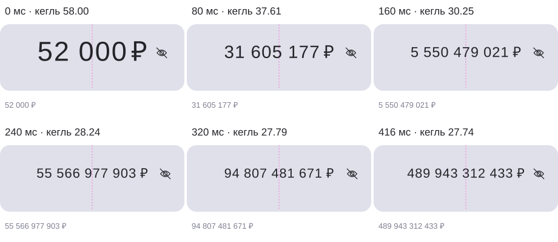
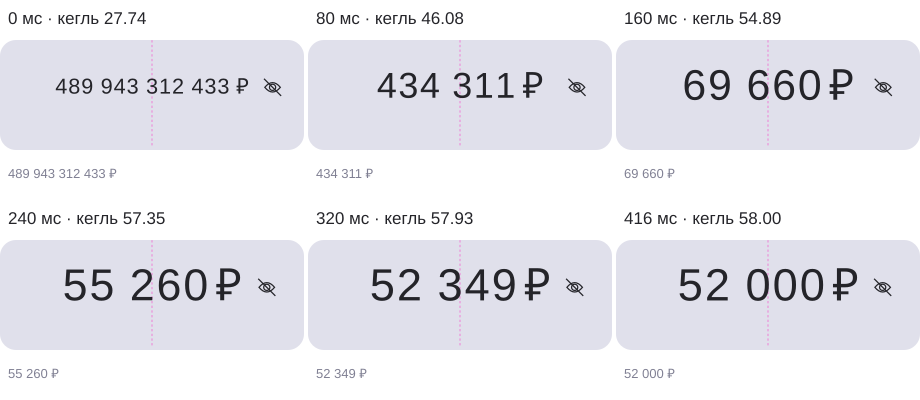

# 01 · Смена общей суммы и размера шрифта

[← Все взаимодействия](../README.md) · [Прототип wb-test-1](https://lyosha.fun/wb-test-1/) · [Figma](https://www.figma.com/design/ughEdjxWnsWCp0GKZtsemH/?node-id=62191-146161)

Версия 7 · 11 ноября 2026. Анимация перенесена в [wb-test](https://lyosha.fun/wb-test/) с сохранением сумм. В wb-test-1 остаётся пример крупных значений. Названия элементов здесь описательные; разработчики используют свои компоненты.

## Поведение

**Если сумма помещается, кегль не меняется. Уменьшение запускается только при нехватке фактической ширины.** Число и отведённая сумме ширина меняются за 400 мс. Кегль участвует в этом же переходе только когда его начальный и конечный размеры отличаются. У них общий момент начала и окончания. Нет отдельного уменьшения до пересчёта, увеличения после него или дополнительного сдвига в конце.

**Центр строки «сумма + ₽» закреплён по центру доступной области.** Глазик не входит в расчёт этого центра. При изменении ширины границы расходятся или сходятся относительно одной оси. Цифры сохраняют естественные пропорции и расстояния, не сжимаются по горизонтали. ₽ сохраняет размер вместе с числом либо меняет кегль вместе с ним, когда нужен другой размер. Высота строки и серой шапки постоянна.

Глазик плавно следует за отведённой сумме шириной, оставаясь справа, без изменения своего размера и области нажатия. В покое зазор от суммы до области кнопки — 8 единиц макета. Во время перехода он может быть больше: место резервируется под следующие разряды, чтобы число не наезжало на кнопку.

## Запуск и данные

T = 0 — выбор другого режима «На ВБ» / «Для любых покупок». Повторный выбор активного режима ничего не запускает. Целевое значение меняется сразу; промежуточные числа — только визуальный переход, не банковские данные.

В wb-test: **95 775 ₽ ↔ 154 261 ₽**. На ширинах 390/430 при масштабе 100% обе суммы помещаются: кегль **58 → 58** весь переход.

В тесте крупных сумм wb-test-1: **52 000 ₽ ↔ 489 943 312 433 ₽**. Эти значения не ограничивают допустимые суммы. В тесте общие суммы заданы независимо от карточек: **Основной счёт — 1 млн ₽, WB Кэш — 1 млрд ₽ в обоих режимах**. Их баланс не меняется при нажатии. Для продуктовых данных итог приходит из модели приложения. Состав и движение остальных карточек описаны [отдельно](02-accounts.md).

## Последовательность

| От нажатия | Видимый результат |
|---|---|
| 0 мс | Сохраняются текущая сумма, её кегль, ширина и центральная ось. Определяется конечный кегль новой суммы |
| 0–400 мс | Число непрерывно проходит промежуточные значения; ширина плавно идёт к новому значению. Кегль постоянен, если размер подходит; при необходимости он меняется одновременно с числом. Глазик перемещается в том же переходе |
| При появлении разряда | Следующий разряд появляется, когда для него достаточно места; уменьшение кегля для помещающейся строки не требуется; нет внезапного скачка к мелкому шрифту |
| 400 мс | Число точно равно цели. Кегль, ширина, ₽ и глазик одновременно занимают конечные положения |
| После 400 мс | Покой. Доводки размера и центрирования нет |

## Параметры движения

| Параметр | Значение |
|---|---|
| Длительность пересчёта и геометрии | 400 мс; изменение кегля входит в тот же интервал только при необходимости |
| Задержка каждого изменения | 0 мс |
| Общая временная кривая | cubic-bezier(0.22, 1, 0.36, 1) |
| Характер | Быстрый старт общего прогресса, мягкое завершение; без пружины и перелёта |
| Опора | Постоянный центр строки суммы с ₽; глазик отдельно |
| Кегль между состояниями | Если выбранный размер одинаков — постоянен; иначе непрерывный переход к новому размеру |
| Прозрачность и поворот цифр | Не меняются при обычном пересчёте; цифры не выезжают по отдельности |
| Уменьшение движения | Новая сумма и её геометрия сразу, без промежуточного движения |

**10% — шаг подбора конечного кегля, а не ступень анимации.** Сначала проверяем фактическую ширину базовым кеглем. Если строка помещается, уменьшение не нужно, независимо от количества символов. Иначе выбираем подходящий размер по [правилам масштабирования](../amount-scaling.md). Переход к нему непрерывный, только если размеры отличаются. Межстрочный интервал меняется пропорционально кеглю. Размер не пересчитывается заново от каждой промежуточной цифры.

При большой разнице значений пересчёт проходит порядки величины. Его числовая скорость не обязана быть линейной: общая временная кривая управляет прогрессом, а появление новых разрядов согласовано с доступным местом. Поэтому «80% времени» не означает «80% денежной разницы». В обратном направлении используется обратный путь от текущего состояния.

## Как избежать рывков

Все изменения используют **один общий прогресс**: 400 мс, задержка 0 мс, cubic-bezier(0.22, 1, 0.36, 1). Одинаковой длительности у независимых переходов недостаточно: число, кегль цифр и ₽, отведённая ширина и положение глазика должны соответствовать одному моменту времени.

| Элемент | Требуемое поведение | Что даёт рывок и недопустимо |
|---|---|---|
| Глазик | Следует за плавно меняющейся отведённой шириной. Размер и область нажатия постоянны; центр суммы рассчитывается без глазика | Привязывать положение к мгновенной ширине каждой промежуточной строки или сразу ставить в конечную позицию |
| Кегль | Подобрать конечный размер до перехода и непрерывно менять его от текущего. Если размеры одинаковы — сохранять кегль на всех кадрах | Повторно подбирать размер под каждое промежуточное число; показывать уменьшение ступенями по 10% |
| Знак ₽ | Тот же текущий кегль и тот же прогресс, что у цифр. Если знак отдельный, его масштаб синхронен с цифрами. Сохраняются пропорции и выравнивание по базовой линии | Собственная задержка, независимое увеличение, округление размера до видимых ступеней или скачок на последнем кадре |
| Большая разница сумм | Число проходит порядки величины одновременно с изменением размера. Следующий разряд появляется, когда для него достаточно места | Держать длинное число почти до конца и затем одним кадром заменять его короткой суммой с крупным шрифтом |
| Завершение | На 400 мс все величины уже в конечном состоянии | Отдельно доводить кегль, ₽, глазик или центр после окончания пересчёта |

**Не округлять прогресс, кегль и положение до ступеней.** Отбрасывание копеек относится только к показываемому числу. Центр суммы с ₽ и высота строки остаются постоянными; масштабировать всю группу вместе с глазиком нельзя. Резервируемая ширина и фактическая ширина промежуточного числа могут отличаться: число с ₽ центрируется внутри резерва, глазик следует за резервом.

При переходе от длинной суммы к короткой шрифт растёт уже во время пересчёта. В обратную сторону уменьшение и пересчёт тоже начинаются вместе. Линейная интерполяция денежной разницы при очень разных порядках может удерживать длинную строку почти весь переход; она не заменяет согласование числа с доступным местом. [Общая модель движения](../implementation.md#единый-прогресс-без-рывков).

### Покадровая приёмка

Снять оба направления и проверить кадры **0 / 100 / 200 / 300 / 400 мс**, а также соседние кадры в местах смены разряда. Приведённые моменты — контрольные точки непрерывной анимации, а не пять её шагов.

| Момент | Что проверять |
|---|---|
| 0 мс | Текущее видимое состояние сохранено: нет предварительного скачка размера или глазика |
| 100 / 200 / 300 мс | При различающейся ширине глазик проходит промежуточные позиции. При различающемся кегле цифры и ₽ имеют одинаково изменяющийся промежуточный размер; если кегль совпадает, он постоянен |
| 400 мс | Точная целевая сумма, конечные размер и ширина; глазик уже на месте |
| Следующие кадры | Нет дополнительного сдвига или изменения размера; центр и высота строки прежние |

Проверить обычные суммы 95 775 ↔ 154 261 ₽, тестовые 52 000 ↔ 489 943 312 433 ₽ и пару из записи разработчиков 128 340 ↔ 95 775 000 000 000 ₽. Это примеры для проверки, а не новые продуктовые балансы. Повторить обратный тап на 100–200 мс: весь переход продолжается от текущих видимых величин, включая положение глазика, без сброса.

## Примеры по кадрам

Реконструкция по измеренным состояниям работающего прототипа на ширине 390, масштаб шрифта 100%. Розовая ось показывает неизменный центр. Размеры относятся к этому примеру; не закреплять их для всех устройств и сумм. 416 мс — первый снятый кадр после номинального окончания в 400 мс, а не дополнительная длительность.

| Кадр | Направление | Сумма | Кегль в примере |
|---|---|---|---|
| 0 мс | На ВБ | 52 000 ₽ | 58.00 |
| 80 мс | На ВБ | 31 605 177 ₽ | 37.61 |
| 160 мс | На ВБ | 5 550 479 021 ₽ | 30.25 |
| 240 мс | На ВБ | 55 566 977 903 ₽ | 28.24 |
| 320 мс | На ВБ | 94 807 481 671 ₽ | 27.79 |
| 416 мс | На ВБ | 489 943 312 433 ₽ | 27.74 |
| 0 мс | Для любых покупок | 489 943 312 433 ₽ | 27.74 |
| 80 мс | Для любых покупок | 434 311 ₽ | 46.08 |
| 160 мс | Для любых покупок | 69 660 ₽ | 54.89 |
| 240 мс | Для любых покупок | 55 260 ₽ | 57.35 |
| 320 мс | Для любых покупок | 52 349 ₽ | 57.93 |
| 416 мс | Для любых покупок | 52 000 ₽ | 58.00 |

## Прерывание и доступность

Повторное переключение разрешено в любой момент. Новый переход начинается от **текущих** числа, кегля, ширины и положения глазика и длится 400 мс до новой цели. Нет возврата к старой сумме, базовому кеглю или нулевой ширине. Центр остаётся тем же.

Скрытая сумма не вспыхивает при смене режима. В доступном описании — полная конечная сумма, если она открыта; промежуточные значения не озвучиваются на каждом кадре. Скрытое значение не озвучивается. Анимация скрытия/показа остаётся самостоятельной и не меняется этим обновлением.

## Проверка

- [x] Для помещающихся 95 775 / 154 261 ₽ кегль 58 постоянен весь переход на 390/430 при масштабе 100%.
- [x] В примере крупных сумм число и требуемое изменение кегля происходят одновременно и завершаются за 400 мс с допуском кадра.
- [x] Центр остаётся на месте в обоих направлениях; высота шапки не меняется.
- [x] Цифры не сжаты, ₽ не наезжает на последнюю цифру, сумма не сталкивается с глазиком.
- [x] Ширины 320 / 390 / 430 и масштаб шрифта 100% / 150%: конечный кегль выбирается шагами ×0.9, минимум 16 sp; при переполнении есть fade справа.
- [x] Быстрое обратное переключение, скрытие/показ баланса и уменьшение движения.
- [x] 1 млн ₽ и 1 млрд ₽ в постоянных карточках сохраняются при смене режима.
- [ ] Проверка в нативных приложениях и на физических устройствах.

Проверено в браузерном прототипе; это не подтверждение поведения iOS/Android-приложений. [Подробности проверки](../verification.md). Архивные записи от 22 октября относятся к предыдущей анимации и не являются эталоном этой версии.
