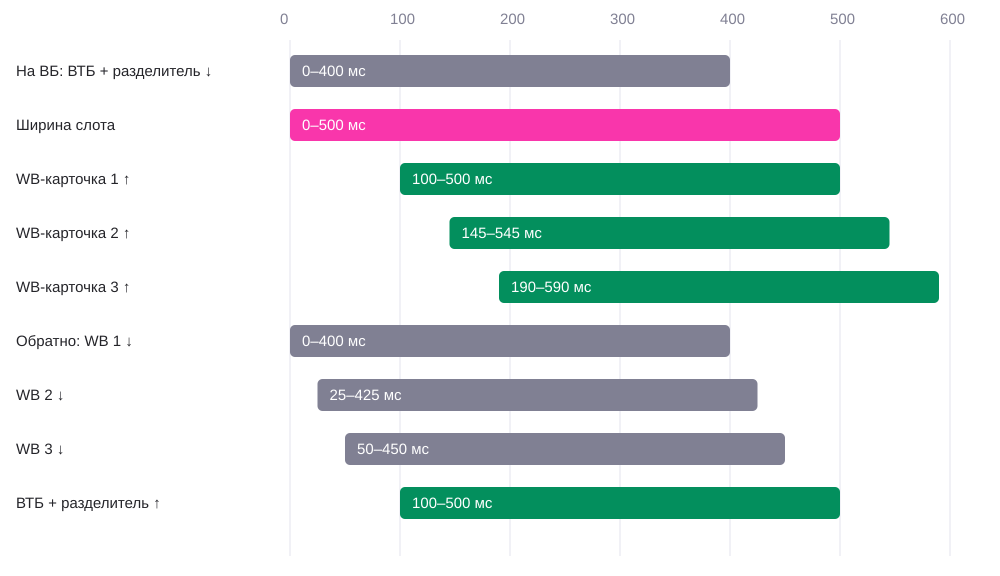

# 02 · Появление и исчезновение карточек счетов

[← Все взаимодействия](../README.md) · [Логика](../behaviour.md) · [Параметры](../motion-reference.json)

Статус: реализовано на `wb-test`. Версия 1 · 22 октября 2026.

## Зачем

Показать, какие средства доступны в выбранном режиме, сохранив понятное место общей части карусели. WB-карточки и внешний счёт заменяют друг друга; основной счёт, подключённый Кэш и «Открыть ещё» остаются.

## Как запускается

Нажатие «На ВБ» или «Для любых покупок». Момент 0 — изменение режима. Доступность целевой группы меняется сразу. Скрываемая группа с этого момента получает `inert` и `aria-hidden`, хотя визуально ещё завершает выход.

## Пример и последовательность

[Видео в исходном темпе](../media/mode-switch.mp4) · [Кадры прототипа с управляемым временем](../media/accounts-frames.jpg)

### Для любых покупок → На ВБ

| От нажатия | Элемент | Что видно |
|---|---|---|
| 0–400 мс | ВТБ + разделитель | Единая группа опускается с Y=0 на Y=115 px за нижний край маски |
| 0–500 мс | Общий слот | Ширина 132 → N × 126 px; «Открыть ещё» следует за правой границей |
| 100–500 мс | Первая WB-карточка | Поднимается с Y=115 до Y=0 |
| 145–545 мс | Вторая, если есть | То же движение с задержкой 45 мс относительно первой |
| 190–590 мс | Третья, если есть | То же движение с ещё одной задержкой 45 мс |

### На ВБ → Для любых покупок

| От нажатия | Элемент | Что видно |
|---|---|---|
| 0–400 мс | Первая WB-карточка | Опускается с Y=0 на Y=115 px |
| 25–425 мс | Вторая, если есть | Выход с задержкой 25 мс |
| 50–450 мс | Третья, если есть | Выход с задержкой 50 мс |
| 100–500 мс | ВТБ + разделитель | Вместе поднимаются с Y=115 до Y=0 |
| 0–500 мс | Общий слот | Ширина N × 126 → 132 px |

Группы движутся одновременно с перекрытием по времени. Не ждать полного исчезновения старой перед входом новой. При одной WB-карточке ширина слота равна 126 px, при двух — 252 px, при трёх — 378 px. Переход на ВБ целиком занимает 500 / 545 / 590 мс соответственно; обратный — 500 мс.

## Параметры и их смысл

| Параметр | Значение | Что меняет |
|---|---|---|
| Движение карточки | 400 мс; cubic-bezier(0.22, 1, 0.36, 1) | Быстрый выход из-за края, мягкая остановка |
| Вертикальный путь | 115 px | Полностью скрывает карточку высотой 99 px |
| Вход WB | 100 + 45 × i мс, i с нуля | Лёгкая последовательность слева направо |
| Выход WB | 25 × i мс | Более плотная последовательность при уходе |
| Вход ВТБ | Задержка 100 мс | Даёт исходным карточкам начать уход |
| Выход ВТБ | Без задержки | Сразу освобождает состояние |
| Ширина слота | 500 мс; cubic-bezier(0.4, 0, 0.2, 1) | Убирает резкое схлопывание места между общими карточками |
| Геометрия | Карточка 118 × 99 px; шаг WB 126 px; маска 115 px высотой | 8 px между WB-карточками и резерв после последней |
| ВТБ и разделитель | Единая группа шириной 132 px | Разделитель никогда не остаётся отдельно |
| Шапка | 455 px + safe-area-inset-top | Не меняет высоту при смене режима |
| Opacity / scale / rotation | 1 / 1 / 0 в обычном режиме | Исчезновение обеспечивается маской, не затуханием |

Обе группы расположены абсолютно в одном слоте, с одинаковым началом X=0. Высота и нижняя граница маски постоянны, а её ширина меняется. Шапка тоже обрезает выходящий контент. Поэтому уменьшение ширины может дополнительно скрывать правую часть исходной группы — не заменять эту геометрию простым удалением элементов из flex-ленты.

## Повторное действие и прерывание

Режим можно сменить до окончания движения. Стабильные ключи сохраняют элементы, а текущие Y и ширина перенаправляются к новой цели без перемонтирования и мигания. Задержки назначаются для нового направления заново. Не обнулять scrollLeft при переключении. При сокращении общей длины браузер может ограничить scrollLeft новым максимумом: это граница прокрутки, а не отдельная анимация карточки.

Состав демонстрации постоянен. Компонент принимает массив WB-карточек и рассчитывает ширину по его длине; независимое добавление/удаление карточек сервером во время перехода не имеет отдельного сценария в прототипе. Для нуля карточек нужна отдельная продуктовая договорённость; здесь описаны N=1, 2, 3.

## Уменьшение движения и доступность

В reduced motion вертикальное смещение отключается и ширина меняется сразу. Группы меняют opacity за 150 мс без задержек. Скрытая группа сразу недоступна для кликов, табуляции и озвучивания. Переключатель имеет роли tablist/tab/tabpanel, состояние выбора и переключение стрелками клавиатуры.

## Как проверить

- [ ] ВТБ и разделитель исчезают вместе в режиме «На ВБ».
- [ ] Основной счёт, Кэш и «Открыть ещё» не исчезают.
- [ ] Шапка не меняет высоту; карточки обрезаются одной постоянной нижней границей.
- [ ] Проверены N=1, N=2, N=3: ширина и задержки соответствуют фактическому количеству.
- [ ] На быстрых повторных нажатиях нет мигания, перемонтирования и скачка ширины.
- [ ] После горизонтальной прокрутки смена режима не сбрасывает ленту в начало вручную.
- [ ] Скрытые карточки не получают фокус; reduced motion заменяет движение коротким затуханием.

## Где находится реализация

- [main.tsx](../source/main.tsx): `AccountCarousel`, `mode-accounts-slot`, обе группы.
- [styles.css](../source/styles.css): маски, размеры, абсолютная компоновка.
- [Проверки основного сценария](../source/unified.spec.ts).

[← Общая сумма](01-balance.md)
