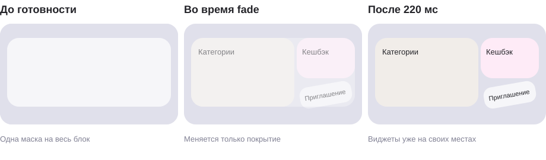

# 03 · Начальная загрузка главного экрана

[← Все взаимодействия](../README.md) · [Figma](https://www.figma.com/design/ughEdjxWnsWCp0GKZtsemH/?node-id=63517-30002) · [Макет загрузки](https://www.figma.com/design/ughEdjxWnsWCp0GKZtsemH/?node-id=62191-144245) · [Прототип](https://lyosha.fun/wb-test/) · [iOS](../examples/initial-load/InitialLoad.swift) · [Android](../examples/initial-load/InitialLoad.kt)

Версия 4 · 12 ноября 2026. Названия элементов описывают их роль; имена компонентов и архитектуру выбирают разработчики.

## Поведение

**Верхний блок промовиджетов загружается одним общим скелетоном с шиммером.** Он покрывает всю область с категориями, кешбэком и приглашением друзей. Внутри нет отдельных заглушек, промежутков и независимых проходов для каждого виджета. Остальные скелетоны экрана сохраняются.

После готовности скелетоны плавно исчезают и открывают готовую композицию. **Кешбэк сразу имеет конечную высоту 68; реферальная карточка сразу имеет масштаб 100%, собственную прозрачность 100% и наклон −10°.** Отдельной анимации реферальной программы нет: карточка не проявляется сама, не увеличивается и не поворачивается. Общий fade покрытия не является отдельным появлением приглашения.

Высота шапки, положение баланса, переключателя и карусели постоянны. Суммы и состав карточек сохраняются.

## Запуск

Приложение определяет длительность загрузки. Эта спецификация не задаёт минимум, максимум, число циклов или автоматический выход по тайм-ауту. Шиммер повторяется всё время ожидания.

**T = 0 — приложение сообщает, что контент готов к показу.** В этот момент начинается fade скелетонов. Ждать конца прохода шиммера не нужно. Короткая и долгая загрузка используют одинаковый переход после T.

Загрузка относится к первому открытию главного экрана. Возврат из дочернего экрана и переключение режима покупок её не повторяют.

## Пример и последовательность

[Видео MP4 · обычная скорость](../media/initial-load/initial-load.mp4) · [Кадр загрузки](../media/initial-load/01-skeleton.png) · [Готовый экран](../media/initial-load/ready.png)

Запись актуального локального wb-test, опубликованного 12 ноября: 390 × 844, без ускорения и постановочных переходов. Видны общий шиммер и fade покрытия; карточки уже в конечном положении. Длительность ожидания в записи демонстрационная, а не требование к приложению.

Схема показывает только верхние промовиджеты. Это пояснение состояний, а не запись устройства; оформление готовых карточек берётся из актуального макета.

| От готовности | Что происходит |
|---|---|
| До T | Один общий шиммер верхнего блока; остальные скелетоны на своих местах. Ожидание произвольной длительности |
| T = 0 | Готовые виджеты уже расположены в конечной геометрии под покрытием. Действия становятся доступны |
| 0–220 мс | Прозрачность скелетонов 100% → 0%, плавное замедление. Геометрия виджетов не меняется |
| После 220 мс | Покрытие отсутствует. Кешбэк высотой 68; приглашение в масштабе 100%, под углом −10°. Дополнительных этапов нет |

## Параметры

| Элемент | Значение |
|---|---|
| Верхний скелетон | Один прямоугольник на всю ширину промоблока; высота 116; скругление 20; боковые отступы 16 |
| Ширина при экране 390 | 358; на других ширинах зависит от доступного места |
| Fade скелетонов | 220 мс; задержка 0; прозрачность 100% → 0%; ease-out, cubic-bezier(0, 0, 0.58, 1) |
| Кешбэк после загрузки | Ширина 119, высота 68; без перехода 116 → 68 |
| Приглашение друзей | Масштаб 100%, собственная прозрачность 100%, угол −10°; постоянны на всём раскрытии |
| Высота шапки и раскладка | Постоянны, без сдвигов нижней части экрана |

116 — высота общего скелетона, **не начальная высота карточки кешбэка**. Размеры — единицы макета; при переносе используйте соответствующие pt на iOS и dp на Android. Это не физические пиксели устройства.

## Шиммер

[Эталон Wasabi DS](https://www.figma.com/design/YOT7K99jin5akNLlHGviGQ/?node-id=736-1047).

| Параметр | Значение |
|---|---|
| Повторение | До готовности контента, без ограничения числа циклов |
| Цикл | Проход 1000 мс + пауза 1000 мс |
| Начало | Первый проход сразу, пауза после него |
| Направление и путь | Слева направо, 680 единиц макета, линейное движение |
| Полоса | Ширина 50; наклон −75° к горизонтали |
| Градиент | Прозрачность 0% → 100% → 0%; точки 0 / 25 / 50 |
| Цвет центра | Фон под заглушкой: #E0E0EB в шапке, белый в теле |
| Основа | #F6F6F9 |
| Маска | Скруглённые границы скелетона; его размер постоянен |

Для верхнего блока полоса проходит через **единую маску**, без разделения на карточки. Конец цикла не означает готовность. По событию готовности затухание начинается сразу, даже посреди прохода.

## Взаимодействие

До T действия главного экрана недоступны, для средств доступности обозначается загрузка; декоративные заглушки не озвучиваются. С момента T доступны все готовые действия, включая приглашение. Исчезающее покрытие не перехватывает нажатия.

Таймеры каруселей разрешены с готовности контента при активном главном экране: категории кешбэка — 20 секунд, рекламные баннеры — 6 секунд до первого автопереключения. Старую последовательность 1280 мс ждать не нужно.

Возврат из дочернего экрана сохраняет достигнутое состояние. При окончательном закрытии главного незавершённый переход прекращается.

## Уменьшение движения

Во время ожидания — те же статичные скелетоны без движущейся полосы. Длительность ожидания по-прежнему задаёт приложение. По готовности покрытие снимается сразу, без fade. Конечная геометрия и доступность действий такие же, как в обычном режиме.

## Приёмка

- [ ] Верхний блок закрыт одной заглушкой: нет шва между категориями и кешбэком, нет отдельного скелетона приглашения.
- [ ] До готовности шиммер не завершается сам. Готовность посреди прохода запускает fade без ожидания конца цикла.
- [ ] На 0 / 110 / 220 мс кешбэк имеет высоту 68, приглашение — масштаб 100%, собственную прозрачность 100%, угол −10°. Меняется только покрытие.
- [ ] После 220 мс нет дополнительного уменьшения, проявления, масштабирования или поворота.
- [ ] Шапка, баланс и карусель сохраняют положение; суммы не меняются из-за загрузки.
- [ ] Возврат и переключение режима не повторяют загрузку.
- [ ] Уменьшение движения сохраняет правильное конечное состояние без промежуточных кадров.

В веб-прототипе 12 ноября прошли сборка и 7 проверок загрузки и суммы. Нативная интеграция требует отдельной приёмки; отметки выше оставлены для команды приложения.

## Примеры для платформ и архив

- [iOS · SwiftUI](../examples/initial-load/InitialLoad.swift)
- [Android · Jetpack Compose](../examples/initial-load/InitialLoad.kt)
- [Подключение и границы примеров](../examples/initial-load/README.md)

Примеры получают готовность от приложения и раскрывают готовый контент через общее покрытие. Отдельного состояния анимации кешбэка или приглашения в них нет.

[Видео 10 ноября](https://github.com/alekseipopov13/wb/blob/bdd856b8c38df4d50cce1957f1d8732384226941/docs/home-motion/media/initial-load/initial-load.mp4), [GIF 10 ноября](https://github.com/alekseipopov13/wb/blob/bdd856b8c38df4d50cce1957f1d8732384226941/docs/home-motion/media/initial-load/initial-load.gif) и [снимок исходников](../source/initial-load-2026-11-10/) — **архив старого решения** с уменьшением и поворотом. Они не являются эталоном текущей загрузки. Актуальны новая запись 12 ноября, эта спецификация, схемы выше и живой прототип.
