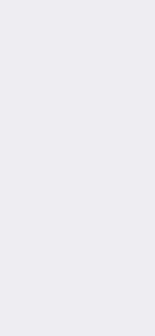
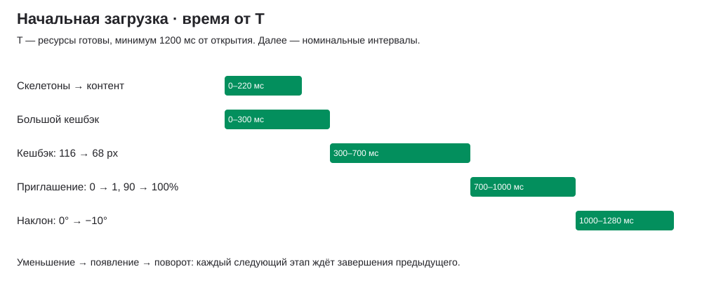

# 03 · Начальная загрузка главного экрана

[← Все взаимодействия](../README.md) · [Параметры](../motion-reference.json) · [Figma: начальная загрузка](https://www.figma.com/design/ughEdjxWnsWCp0GKZtsemH/?node-id=63517-30002)

Статус: реализовано в [wb-test](https://lyosha.fun/wb-test/). Версия 1 · 10 ноября 2026. Описан текущий вариант: уменьшение 400 мс, поворот 280 мс.

## Зачем

Сначала показать структуру экрана скелетонами. После загрузки раскрыть контент, уменьшить виджет «Кешбэк», затем показать приглашение друзей и наклонить его в конечную позицию. Остальной экран сохраняет свою геометрию.

## Как запускается

Открытие или полная перезагрузка `wb-test`. Последовательность запускается один раз при создании главного экрана. Для повторного просмотра обновить страницу; переключение режима покупок и возврат назад её не повторяют. `wb-test-1` в описание не входит.

Есть две точки отсчёта:

- **Открытие** — начало ожидания ресурсов и показ скелетонов.
- **T** — переход к контенту. Измеряем длительность R до завершения ожидания шрифтов и декодирования смонтированных неленивых изображений. В обычном режиме `T = max(1200, min(R, 3500)) мс` от открытия. Отказы ресурсов считаются завершённым ожиданием; зависший запрос не удерживает скелетоны дольше 3500 мс.

Это параметры демо, а не задержка серверного запроса. Банковские данные сейчас локальные. При переносе на продукт необходимо отдельно связать готовность с данными и состояниями ошибок.

## Пример и последовательность

[Видео без изменения скорости](../media/initial-load/initial-load.mp4) · [Кадры и фактические значения](../media/initial-load/capture.json) · [Открыть прототип](https://lyosha.fun/wb-test/)

Запись снята с работающего компонента при ширине 390 CSS px. Время видео считается от начала записи браузера; таблица ниже — от T. Небольшая разница с номинальными границами обусловлена кадрами браузера и моментом готовности ресурсов.

| Интервал | Элемент | Видимый результат |
|---|---|---|
| Открытие → T | Скелетоны | Заглушки виджетов, переключателя, суммы, счетов, действий, баннеров, истории и продуктов. Логотип, служебные иконки и таббар видны |
| T → T + 220 мс | Покрытие скелетонов | Opacity 1 → 0; под ним уже смонтирован контент. Покрытие затем удаляется |
| T → T + 300 мс | Кешбэк | Полная высота 116 px; приглашение скрыто. Последние 80 мс контент виден без покрытия |
| T + 300 → T + 700 мс | Кешбэк | Высота 116 → 68 px за 400 мс; верхняя граница неподвижна, нижняя поднимается на 48 px |
| T + 700 → T + 1000 мс | Приглашение | Одновременно opacity 0 → 1 и scale 90% → 100% за 300 мс. Угол всё ещё 0° |
| T + 1000 → T + 1280 мс | Приглашение | Поворот 0° → −10° за 280 мс; opacity и scale уже 100% |
| После T + 1280 мс | Готовый экран | Кешбэк 68 px; приглашение непрозрачное, полного размера, под углом −10° |

Уменьшение, появление и наклон идут последовательно. Следующий этап запускается **по фактическому завершению анимации**, а не независимым таймером. Поэтому таблица — номинальная шкала, а не обещание завершения на конкретной миллисекунде при задержках кадров.

## Параметры и их смысл

| Параметр | Значение | Видимый результат |
|---|---|---|
| Минимальный показ скелетонов | 1200 мс от открытия | Даже при тёплом кеше структура успевает появиться |
| Ограничение ожидания ресурсов | 3500 мс от открытия | Загрузка не остаётся навсегда при зависшем ресурсе |
| Исчезновение покрытия | 220 мс от T | Контент открывается через прозрачность; стандартный tween Motion без переопределения ease |
| Пауза до уменьшения | 300 мс от T, включает fade 220 мс | Пользователь сначала видит большой кешбэк |
| Уменьшение | 400 мс; 116 → 68 CSS px | Меняется высота карточки, а не масштаб её текста |
| Появление приглашения | 300 мс; opacity 0 → 1; scale 0.9 → 1 | Карточка проявляется и немного увеличивается без переноса по X/Y |
| Поворот | 280 мс; 0° → −10° в CSS | Наклон начинается после полного появления |
| Кривая трёх движений | cubic-bezier(0.22, 1, 0.36, 1) | Быстрое начало и мягкое замедление, без пружины и перелёта |
| Опора приглашения | Центр собственного бокса, 50% / 50% | Размер и угол меняются вокруг одного центра |
| Нижний отступ суммы кешбэка | 12 CSS px | При уменьшении сумма перемещается вверх вместе с нижней границей; кегль не меняется |
| Ширина кешбэка в демо | 119 CSS px | При уменьшении остаётся постоянной |
| Шапка в демо | 452 CSS px + верхняя безопасная область | Высота постоянна на всех этапах, сумма и карусель не подпрыгивают |

Размеры выше описывают текущий макет; на другой платформе брать начальный и конечный размер из соответствующих состояний дизайна. Размеры карточек и величина общей суммы не пересчитываются этой анимацией.

## Шиммер

Эталон: [Wasabi DS · Animation](https://www.figma.com/design/YOT7K99jin5akNLlHGviGQ/?node-id=736-1047).

- Цикл 2000 мс: движение 1000 мс, затем пауза 1000 мс. Первый проход начинается сразу; пауза находится после прохода.
- Направление слева направо; линейное перемещение на 680 CSS px.
- Полоса шириной 50 CSS px: прозрачная → непрозрачная → прозрачная, точки градиента 0 / 25 / 50 px.
- Наклон полосы: диагональ −75° к горизонтали; в CSS — `skewX(-15deg)` вертикальной полосы.
- Цвет центра — фон под скелетоном: `#E0E0EB` в шапке, белый в теле. Основа заглушек `#F6F6F9`. По краям прозрачность 0%.
- Полоса обрезается по форме каждой заглушки; исходный left −150 CSS px. Заглушки не пульсируют размером.
- В текущем русскоязычном прототипе реализовано только LTR. Обратное направление RTL из дизайн-системы здесь не проверялось.

## Повторное действие и прерывание

Пока состояние `loading`, весь главный экран `inert`, а контейнер сообщает `aria-busy=true`. Заглушки декоративные (`aria-hidden`). С переходом в `loaded` блокировка снимается, хотя покрытие ещё заканчивает fade; само покрытие не перехватывает нажатия. Приглашение недоступно до начала своего появления.

Переход в дочерний экран не перемонтирует главную. Начальная последовательность может завершиться под открытым экраном; возврат не проигрывает её снова. В прототипе нет отдельной паузы этой последовательности при уходе вкладки в фон: планирование кадров/таймеров ограничивает браузер. При уничтожении главного экрана ожидающие таймеры очищаются.

Автопереключения каруселей включаются только после `ready`, если главный экран активен: категории кешбэка — через 20 000 мс, рекламные баннеры — через 6000 мс. У каждой карусели сохраняются собственные правила паузы и ручного переключения. Суммы, режимы и наборы счетов эта последовательность не изменяет.

## Уменьшение движения и доступность

При `prefers-reduced-motion: reduce` шиммер отключён. Минимальное ожидание сокращено до 200 мс, предельное ожидание ресурсов остаётся 3500 мс. После готовности сразу показывается конечная геометрия: кешбэк 68 px, приглашение scale 1, opacity 1 и угол −10°. Fade покрытия и промежуточные фазы уменьшения/появления/поворота пропускаются. Данные и действия те же.

## Как проверить

- [x] До контента видны скелетоны; нажатия на главный экран заблокированы.
- [x] Большой кешбэк виден до уменьшения; его высота проходит промежуточные значения между 116 и 68 px.
- [x] Во время уменьшения приглашение невидимо.
- [x] При появлении меняются opacity и scale, угол остаётся 0°.
- [x] Во время поворота opacity уже 1; конечный угол −10°.
- [x] Высота шапки постоянна; возврат из дочернего экрана не возвращает скелетоны.
- [x] Reduce Motion отключает шиммер и геометрические переходы.
- [x] После готовности сохраняются переключение режимов, пересчёт суммы, скрытие баланса и 20-секундный таймер категорий.

Обычный сценарий и Reduce Motion проверены браузерными тестами. Предельные 3500 мс и обработка отказов ресурсов описаны по коду; отдельного сетевого stress-теста нет.

## Где находится реализация

[Отдельный снимок от 10 ноября](../source/initial-load-2026-11-10/README.md) содержит актуальные файлы этой анимации; архив смены режима от 22 октября не перезаписан.

- [HomeIntro.tsx](../source/initial-load-2026-11-10/HomeIntro.tsx): ожидание ресурсов, состояния, скелетоны.
- [main.tsx](../source/initial-load-2026-11-10/main.tsx): `PromoCards`, завершение каждого этапа, доступность и запуск таймеров.
- [styles.css](../source/initial-load-2026-11-10/styles.css): геометрия и шиммер.
- [home-intro.spec.ts](../source/initial-load-2026-11-10/home-intro.spec.ts): наблюдение реальных кадров, последовательность, повторное открытие и Reduce Motion.
